# Awesome Mobile Field Service Application (FSM) 📱⚡

  

> A curated directory of premier **Mobile Field Service Application (FSM)** software, work order management tools, and technician dispatch systems. Discover top SaaS platforms and self-hosted open-source solutions featuring offline-first mobile apps for HVAC, plumbing, electrical, maintenance, and deskless field operations.

### 🔍 Quick Index & Search Keywords
`field-service-management` • `mobile-fsm` • `technician-dispatch` • `work-order-software` • `offline-first-mobile` • `deskless-workforce` • `job-scheduling` • `hvac-software` • `plumbing-dispatch` • `route-optimization`

---

> 🌟 **Star this repository** if you find it helpful for discovering and comparing Field Service Management software! 🌟

---

## 📋 Table of Contents

- [Sector Overview & Market Dynamics](#-sector-overview--market-dynamics)
- [SaaS / Hosted Platforms](#-saas--hosted-platforms)
  - [ServiceTitan Mobile](#servicetitan-mobile)
  - [Jobber Mobile](#jobber-mobile)
  - [Housecall Pro App](#housecall-pro-app)
  - [Salesforce Field Service App](#salesforce-field-service-app)
  - [Skedulo Plus](#skedulo-plus)
  - [ServiceMax Go](#servicemax-go)
- [Open-Source Software](#-open-source-software)
  - [1. OCA / Field Service](#1-oca--field-service-)
  - [2. Azure Field Engineer Mobile App](#2-azure-field-engineer-mobile-app-)
  - [3. OpenFieldService](#3-openfieldservice-)
  - [4. EasyDispatch](#4-easydispatch-)
  - [5. Beveren FSM for ERPNext](#5-beveren-fsm-for-erpnext-)
  - [6. Witness Work](#6-witness-work-)
  - [7. Geoclarity](#7-geoclarity-)
  - [8. OpenFieldPro](#8-openfieldpro-)
  - [9. Mobo Field Service for Odoo](#9-mobo-field-service-for-odoo-)
  - [10. SiteTrackr](#10-sitetrackr-)
- [Comparison at a Glance](#-comparison-at-a-glance)
- [Contributing](#-contributing)
- [Support](#-support)
- [Star History](#-star-history)
- [License](#-license)

---

## 🌐 Sector Overview & Market Dynamics

The global Field Service Management (FSM) software market is valued at approximately **$4.5B to $5.5B** and is expanding at a robust **9.5%–12.5% CAGR**, projected to surpass **$10B+ by 2030** driven by cloud mobility, AI route optimization, and IoT predictive maintenance. The industry demonstrates a **hybrid market concentration structure**: while the high-end enterprise segment is heavily concentrated among mega-cap enterprise suites (such as Salesforce, SAP, and ServiceMax/PTC), the mid-market and SME trades landscape remains **moderately to highly fragmented** across hundreds of specialized trade solutions and fast-growing vertical platforms.

---

## 🟦 SaaS / Hosted Platforms ☁️💼

Commercial, cloud-hosted Mobile Field Service Application platforms. These are not open-source but are included as reference points for feature comparison.

| Platform | Company Valuation / Revenue 🏢 | Starting Pricing 💰 | Free Tier / Trial Limit ⏱️ | Key Focus & Mobile Capabilities 📱 |
| :--- | :--- | :--- | :--- | :--- |
| **Salesforce Field Service App** | ~$250B+ Market Cap ($34.8B FY24 Revenue) | $50/user/month (Contractor tier, billed annually) | No direct free trial for Field Service; 30-day trial available for base Service Cloud | Enterprise field service integrated with Salesforce CRM; offline-first mobile app with dispatch, inventory tracking, and scheduling. |
| **ServiceTitan Mobile** | ~$9.0B Valuation (Public: NASDAQ TTAN) | ~$245/technician/month (Starter tier; custom quote, 12+ mo contract) | No free tier or trial (sales-assisted demo and POC only) | Enterprise standard for residential & commercial contractors (HVAC, plumbing, electrical); full technician dispatch, estimates, and payment processing. |
| **Jobber Mobile** | ~$1.0B - $2.5B Valuation ($100M+ ARR) | $39/month (Core plan, billed annually) | 14-day free trial with full Grow plan feature access (no credit card required) | Small-to-midsize trade service businesses (landscaping, cleaning, plumbing); quoting, scheduling, dispatch, and client messaging. |
| **ServiceMax Go** | $1.46B Acquisition (Acquired by PTC) | ~$100/user/month (Annual contract; enterprise custom quote) | No free tier or trial (limited trials only available for select AppExchange add-ons) | Industrial and medical asset maintenance; offline mobile access for complex machinery servicing, IoT telemetry, and work orders. |
| **Housecall Pro App** | ~$1.1B Valuation (Permira-backed unicorn) | $59/month (Basic plan, billed annually) | 14-day free trial (no credit card required) | Mobile-first field service management for home service pros; in-app dispatching, invoicing, customer notifications, and mobile payments. |
| **Skedulo Plus** | ~$500M+ Valuation ($115M+ VC funding) | ~$35/mobile worker/month (Annual enterprise contract) | No standard self-service free trial (customized sales POC / sandbox environment only) | Deskless workforce scheduling, dynamic shift dispatching, and field data capture across healthcare, utilities, and mobile services. |

---

## 🟩 Open-Source Software 🔓🚀

Self-hosted, community-driven Mobile Field Service Application tools and dispatch systems. The open-source ecosystem provides robust options spanning comprehensive ERP-integrated suites, standalone technician dispatchers, and offline-capable mobile clients.

### 1. OCA / Field Service  🌟
- **Repository:** [OCA/field-service](https://github.com/OCA/field-service)
- **Stack:** Python / Odoo / PostgreSQL | **License:** AGPL-3.0
- **Overview:** The official community-driven Field Service Management ecosystem for Odoo maintained by the Odoo Community Association (OCA). It delivers complete field operations management: multi-branch geographic tracking, technician dispatch, territory routing, maintenance orders, stock management, and integration with Odoo mobile interfaces.
- **Best for:** Businesses and enterprises operating on Odoo seeking a battle-tested, modular open-source FSM foundation with full ERP synergy.

### 2. Azure Field Engineer Mobile App  📱
- **Repository:** [Azure-Samples/app-service-mobile-dotnet-fieldengineer](https://github.com/Azure-Samples/app-service-mobile-dotnet-fieldengineer)
- **Stack:** C# / .NET / Xamarin.Forms (iOS & Android) / Azure App Service | **License:** MIT
- **Overview:** Microsoft Azure's reference architecture implementation for enterprise mobile field engineers. It showcases offline synchronization, push notifications, native camera and geolocation capture, customer signatures, and secure cloud sync for on-site field technicians.
- **Best for:** Development teams building cross-platform native mobile field engineering applications on .NET and Azure.

### 3. OpenFieldService  ⚡
- **Repository:** [clawnify/OpenFieldService](https://github.com/clawnify/OpenFieldService)
- **Stack:** TypeScript / Preact / Hono / Cloudflare D1 | **License:** MIT
- **Overview:** Modern, ultra-lightweight open-source field service scheduling and dispatch software designed as a self-hostable alternative to ServiceTitan, Jobber, and Housecall Pro. Features an interactive visual drag-and-drop technician dispatch board, multi-trade support (pest control, HVAC, plumbing, electrical), customer CRM, job estimates, and invoicing.
- **Best for:** Modern trade contractors and developers wanting a fast, edge-deployable scheduling platform with minimal hosting overhead.

### 4. EasyDispatch  🤖
- **Repository:** [alibaba/easydispatch](https://github.com/alibaba/easydispatch)
- **Stack:** Python / PyTorch / Algorithms | **License:** Apache-2.0
- **Overview:** Alibaba's open-source centralized real-time field service dispatching and combinatorial route optimization engine. It models dynamic vehicle and technician routing problems with time windows (VRPTW), real-time traffic conditions, worker skill matching, and on-demand customer order updates.
- **Best for:** Logistics, on-demand field services, and enterprise dispatch systems requiring industrial-grade algorithmic route and job scheduling.

### 5. Beveren FSM for ERPNext  🏢
- **Repository:** [Beveren-Software-Inc/Field_Service_Management](https://github.com/Beveren-Software-Inc/Field_Service_Management)
- **Stack:** Python / Frappe Framework / ERPNext / MariaDB | **License:** GPL-3.0
- **Overview:** A 100% open-source, full-featured Field Service Management application tailored natively for the Frappe/ERPNext ecosystem. Handles end-to-end technician dispatching, service appointments, work orders, on-site task completion, warranty tracking, spare parts tracking, and billing.
- **Best for:** Companies utilizing ERPNext looking for turn-key field service dispatching, warranty tracking, and billing capabilities.

### 6. Witness Work  🛠️
- **Repository:** [leviFrosty/witness-work](https://github.com/leviFrosty/witness-work)
- **Stack:** TypeScript / React Native / Mobile (iOS & Android) | **License:** Open Source
- **Overview:** A user-experience focused mobile field service assistant built specifically for on-site technicians. Designed to streamline work order intake, job checklists, photo documentation, and client handoffs directly from smartphones with an intuitive mobile UI.
- **Best for:** Technicians wanting a streamlined mobile-first field companion app prioritizing speed and mobile UX.

### 7. Geoclarity  🗺️
- **Repository:** [babupriyavrat/Geoclarity](https://github.com/babupriyavrat/Geoclarity)
- **Stack:** PHP / Laravel / MySQL | **License:** Open Source
- **Overview:** An open-source, self-hosted field service management system providing complete operational control without dependency on third-party SaaS subscriptions. Delivers dispatch management, job status tracking, client management, and technician route coordination.
- **Best for:** Self-hosters and service companies wanting a classic, lightweight LAMP/LEMP stack solution for field technician coordination.

### 8. OpenFieldPro  📲
- **Repository:** [niko4244/openfieldpro](https://github.com/niko4244/openfieldpro)
- **Stack:** Fastify / Next.js / React Native (Expo) / PostgreSQL | **License:** AGPL-3.0
- **Overview:** Open-source, self-hostable lead-to-payment field service platform featuring a native Expo/React Native mobile app for technicians. Includes dispatch lanes, unassigned work queues, drag-and-drop reassignment, offline foundation, Stripe checkout, and zero phone-home licensing.
- **Best for:** Trade contractors and full-stack developers wanting an all-in-one lead-to-payment system with a dedicated React Native mobile app.

### 9. Mobo Field Service for Odoo  📦
- **Repository:** [Shahadr4/mobo-field-service](https://github.com/Shahadr4/mobo-field-service)
- **Stack:** Flutter / Dart / Odoo Backend | **License:** Apache-2.0
- **Overview:** Part of the Mobo open-source mobile suite for Odoo. Native iOS and Android Flutter application connecting directly to Odoo Field Service backends, enabling work order management, on-site electronic signatures, time tracking, consumed parts logging, and offline sync.
- **Best for:** Field crews requiring native mobile phone/tablet access to self-hosted Odoo Community or Enterprise instances.

### 10. SiteTrackr  📡
- **Repository:** [Mohammed-6/sitetrackr](https://github.com/Mohammed-6/sitetrackr)
- **Stack:** Fastify / Prisma / React PWA / Dexie (IndexedDB) | **License:** Open Source
- **Overview:** Specialized open-source FieldOps maintenance application engineered for technicians operating at remote sites with intermittent or zero internet connectivity. Utilizes client-side IndexedDB caching via Dexie, dynamic ticket templates, and file attachments in an installable PWA.
- **Best for:** Remote site inspections, utility maintenance, and field operations requiring offline-first PWA data capture.

---

## 📊 Comparison at a Glance

| Software | License ⚖️ | Stack 💻 | Native Mobile 📱 | Offline Support 📴 | Self-Hosted 🏠 | Best For 🎯 |
|----------|---------|-------|---------------|-----------------|-------------|----------|
| **Salesforce Field Service** | Proprietary | Cloud | ✅ iOS/Android | ✅ Offline sync | ❌ Cloud | Enterprise CRM + Field Service |
| **ServiceTitan** | Proprietary | Cloud | ✅ iOS/Android | ✅ Offline cache | ❌ Cloud | Enterprise home services & trades |
| **Jobber** | Proprietary | Cloud | ✅ iOS/Android | ✅ Offline actions | ❌ Cloud | Small-to-midsize trade service businesses |
| **OCA / Field Service** | AGPL-3.0 | Python / Odoo | ✅ Odoo Mobile | ✅ Mobile sync | ✅ Self-hosted | Enterprise Odoo ERP integration |
| **Azure Field Engineer** | MIT | .NET / Xamarin | ✅ iOS/Android | ✅ Offline sync | ✅ Cloud/Self | Reference mobile architecture for Azure |
| **OpenFieldService** | MIT | Preact/Hono/D1 | 🌐 Mobile Web | ❌ Online | ✅ Self-hosted | Lightweight dispatch & scheduling |
| **EasyDispatch** | Apache-2.0 | Python / PyTorch | ❌ Engine | ❌ Engine | ✅ Self-hosted | Real-time AI dispatch & route optimization |
| **Beveren FSM (ERPNext)**| GPL-3.0 | Frappe / ERPNext | ✅ ERPNext Mobile | ✅ Mobile sync | ✅ Self-hosted | ERPNext open-source field service |
| **Witness Work** | Open Source | React Native | ✅ iOS/Android | ✅ Local storage | ✅ Self-hosted | Technician UX-first mobile companion |
| **Geoclarity** | Open Source | PHP / Laravel | 🌐 Mobile Web | ❌ Online | ✅ Self-hosted | Self-hosted LAMP field service |
| **OpenFieldPro** | AGPL-3.0 | Fastify/Next.js/Expo | ✅ React Native | ✅ Offline sync | ✅ Self-hosted | Full lead-to-payment FSM |
| **Mobo (Odoo)** | Apache-2.0 | Flutter / Odoo | ✅ iOS/Android | ✅ Local cache | ✅ Self-hosted | Native Flutter mobile app for Odoo |
| **SiteTrackr** | Open Source | Fastify/React PWA | 📱 Offline PWA | ✅ IndexedDB | ✅ Self-hosted | Remote site inspections & maintenance |

---

## 🤝 Contributing

Contributions are welcome! If you know of an open-source Mobile Field Service Application that should be listed here, please open a pull request with:

- Project name and URL
- Brief description (1–2 sentences)
- Stack and license
- Why it stands out

Please ensure the project is actively maintained (releases within the last 12 months) and genuinely open-source.

**Note on the open-source ecosystem:** The field service management space has **several credible open-source options** in 2026. **OpenFieldPro** is the most comprehensive, covering the full lead-to-payment workflow with a React Native mobile app and no per-seat limits, though it is still in release-candidate hardening . **FlexDesk** offers a modern NestJS/React Native stack with offline-first support and multi-tenancy . **Mobo** is the right choice for organizations already on Odoo wanting a native mobile app that syncs with their existing backend . **SiteTrackr** addresses remote-site maintenance with a PWA approach . **open-fieldservice** provides a lightweight scheduler with a community-added dispatch board . No open-source project fully replicates ServiceTitan's enterprise breadth, but OpenFieldPro and FlexDesk cover the core dispatch-to-payment workflow comprehensively.

---

## 💖 Support

Thank you for exploring this curated list of Mobile Field Service Application platforms! If this repository has helped you or your team evaluate software, please consider showing your support:

- 🌟 **Star this repository** to help others discover it
- 🍴 **Fork and contribute** open-source tools or updates
- 📢 **Share with colleagues** across the field operations & tech community
- ☕ **Support future maintenance:** You can sponsor or buy a coffee via the [GitHub Sponsor Dashboard](https://github.com/sponsors/ishandutta2007).

---

## 📈 Star History

---

## 📄 License

This list is released under CC0 1.0 Universal (Public Domain). The software projects listed retain their respective licenses.

---

⭐ **If this list helped you discover a useful tool, please star the repo!** ⭐
